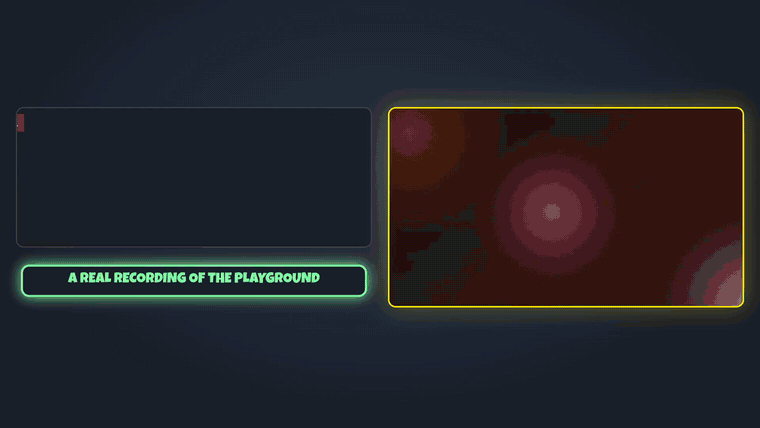
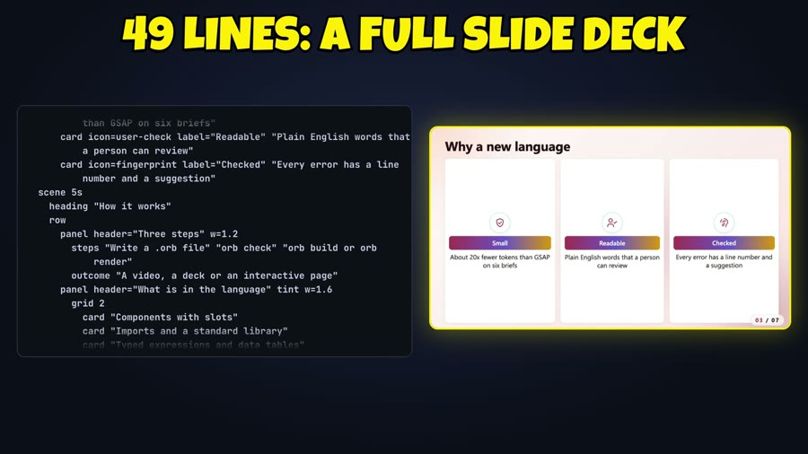
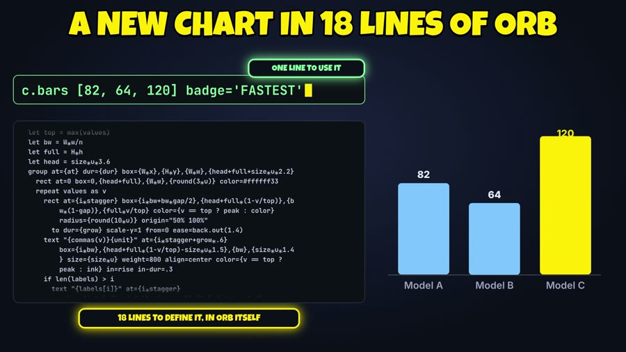
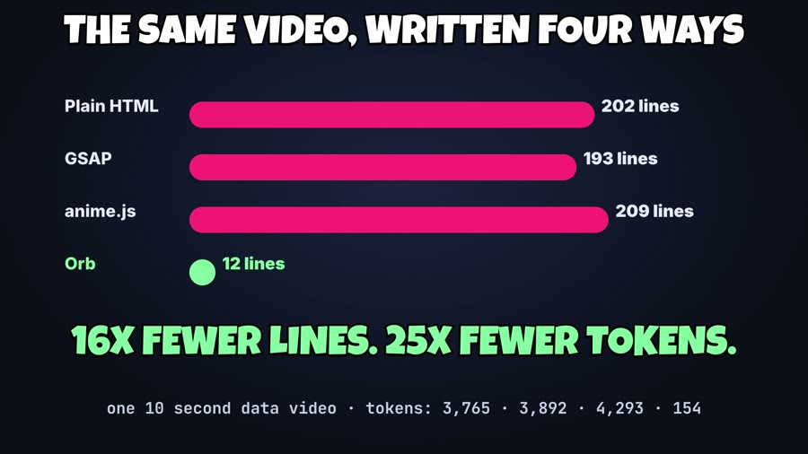

<p align="center">
  
</p>

<h1 align="center">Orb</h1>

<p align="center"><b>A small language AI models write to make videos, presentations and interactive animations.</b><br>
A few readable lines in. A video, a deck or an interactive page out.</p>

<p align="center">
  <a href="https://www.kartit.net/orb/"><b>▶ Try the playground</b></a> &nbsp;·&nbsp;
  <a href="#install">Install</a> &nbsp;·&nbsp;
  <a href="#for-ai-agents">Use it from your AI agent</a> &nbsp;·&nbsp;
  <a href="docs/SPEC.md">The whole language on one page</a>
</p>

<p align="center">
  
  
  
</p>

The recording above is real: five lines typed into the [playground](https://www.kartit.net/orb/), nothing staged.

```
motion "Launch week" accent=#22c55e
  scene 6s
    title "Launch week"
    count "Signups" 4800
    bars 120 340 560 800 1100 labels=Mon,Tue,Wed,Thu,Fri peak="BEST DAY"
```

That is the whole file. `orb build` turns it into one interactive page, `orb render` into an MP4.
Change `accent=`, add `font=display` or `mode=light`, and the whole design follows.

## What you can make

| A slide deck, 49 lines | A new chart, written in Orb itself |
|---|---|
|  |  |

Animated charts and counters, kinetic captions, click-through decks, characters with moods and state machines
that react to hover and click, and full videos with footage, voice-anchored timing and captions.

## Make it yours

Every element takes the same look and place options, so nothing is stuck with a default:

```
motion "Make it yours" 1280x720 accent=#7c5cff mode=dark
  scene 5s
    title "Move it, turn it, restyle it" font=serif size=72 color=#ffffff rotate=-2
    count "Orders this week" 1284 color=#ffd166 font=mono
    bars 12 18 15 22 30 labels=Mon,Tue,Wed,Thu,Fri colors=#ff6b6b,#ffd166,#06d6a0,#4cc9f0,#b388ff tag="NEW RECORD" tag-at=Fri
```

- **Any element:** `color font size weight align x y w h rotate opacity bg pad radius border shadow`.
- **Charts:** a colour per bar or slice, tags, label and value sizes, grid, line stroke and fill, donut hole.
- **Images:** `w h fit radius border shadow`.
- **Decks:** `look=midnight|paper|neon`, a background per slide (colour, gradient or picture), slide transitions
  (`fade slide zoom wipe`) and builds on every part.
- **Characters:** `mascot "Hoot" kind=owl|robot|fox|cat`, one rig, every act and mood on each.

A misspelt option is an error that names the closest one and lists what that element takes. In the
[playground](https://www.kartit.net/orb/) you can also click an item in the preview, drag it to move or resize it,
and change its colour, size and font in a panel; the source line is rewritten as you go.

## Why

Motion graphics, slide decks and interactive pieces are now written by language models, and they write them as
thousands of tokens of HTML, CSS and JavaScript that nobody checks. Orb is the opposite bet: a few readable
lines, a compiler that checks them, and one file for three kinds of output.

The same six briefs, written in one pass by the same model in each format (tokens counted with tiktoken
cl100k; sources and data in [`benchmark/`](benchmark)):

| Format | Tokens written | Times more than Orb |
|---|---|---|
| Orb | 1,026 | 1x |
| GSAP | 20,684 | 20.2x |
| Plain HTML, CSS, JS | 22,319 | 21.8x |
| anime.js v4 | 23,978 | 23.4x |

For the first brief (a 10 second data video): 12 lines of Orb against 193 (GSAP), 202 (plain) and 209 (anime.js).

<p align="center"></p>

What that number does and does not mean:

- These Orb files let the compiler choose the look (layout, colours, fonts, timing). When a file dictates
  every position and size to rebuild an existing video exactly, the saving measured on two real videos was
  4.5x and 5.8x fewer tokens than the HTML they replace.
- A model reads the two cheat sheets ([`docs/SPEC.md`](docs/SPEC.md), [`docs/SPEC-HF.md`](docs/SPEC-HF.md),
  4,428 tokens together) once per session as input. Counted once against these six briefs, Orb is 5,454 tokens
  against 20,684 for GSAP, 3.8x.
- Six briefs is a small test. In a blind quality comparison on those briefs Orb scored 4.10 out of 5 and GSAP
  3.47; treat that as "no measurable quality loss", not as a win.

## Install

```sh
git clone https://github.com/AnassKartit/orb.git
cd orb && npm install

node src/prism.js build examples/q4.prism -o q4.html         # an interactive page
node src/prism.js build examples/std/charts-demo.orb -o out  # a HyperFrames video project
node src/prism.js build examples/std/charts-demo.orb --target web -o demo.html   # the same video as one web page
node src/prism.js render examples/q4.prism q4.mp4 1080       # MP4 (needs Chrome and ffmpeg)
node src/prism.js expand examples/std/charts-demo.orb        # the file with every component expanded
```

Rendering scene files to MP4 uses the installed Chrome and `ffmpeg`. Checking and rendering video-style files
uses the HyperFrames command line (`npx hyperframes`).

## Two kinds of file, one language

- **Scene files** (`scene` blocks): decks, charts, diagrams, characters with moods and state machines. They
  build to one self-contained interactive page: click or arrow through a deck, hover and click a character.
- **Video files** (timed items: `text`, `image`, `video`, `audio`, `rect`, `group`, captions, and animation
  verbs such as `pop`, `wipe`, `count`, `zoom`): they build to a HyperFrames project and render to MP4, or to a
  single web page with `--target web`.

Both share one language layer:

```
import "orb:std/charts" as c            # modules, and a standard library written in Orb
let brand = #ff2d78                     # variables and typed expressions: lists, conditions, functions
def stat(value, label, at=0, color=#FFE600)   # components: named parameters, defaults, slots
  text "{value}" at={at} box={W*.1},{H*.3},{W*.8},260 size=220 color={color} align=center
    pop dur=.3
    slot
  text "{label}" at={at+.3} box={W*.1},{H*.6},{W*.8},80 size=44 align=center in=rise

motion "Demo" 16:9 6s
  rect at=0 color=#0B0F1A
  stat "20x" "fewer tokens than GSAP on six briefs"
    count from=1 to=20 dur=1 format="{n}x"
  c.bars [82, 64, 120] ['A', 'B', 'C'] at=2 badge='FASTEST'
```

`c.bars` is not built into the compiler. It is [18 lines of Orb](std/std/charts.orb) on `rect` and `text`;
copy it, change it, or write your own next to it.

## For AI agents

Orb ships an MCP server, so an agent gets the language guide and the compiler as tools:

```sh
claude mcp add orb -- node /path/to/orb/src/mcp.js
```

Tools: `orb_guide` (the cheat sheets), `orb_check` (errors with a line number and a suggestion), `orb_build`,
`orb_expand`, `orb_render`. The intended loop: read the guide once, write Orb, check until clean, build or render.

Without MCP, paste the two cheat sheets into the model's context. They are the whole language.

## What the compiler checks

Every error names the line and suggests the closest valid word. Authored boxes and sizes are never changed
behind your back; text is auto-fitted but never below 60% of the size you wrote; a text box placed entirely
outside the frame is reported. Video projects are also run through the HyperFrames layout and contrast checks,
mapped back to Orb line numbers.

## Repository

| Path | What |
|---|---|
| `src/lang.js` | the shared language layer: expressions, components, modules |
| `src/prism.js`, `src/runtime.js` | scene files: parser and player |
| `src/hf.js` | video files: HyperFrames target |
| `src/web.js`, `src/web-runtime.js` | video files as one web page |
| `src/mcp.js` | MCP server |
| `std/` | standard library, written in Orb |
| `playground/` | the browser playground (static; `npm run playground` rebuilds the bundle) |
| `docs/` | the two cheat sheets |
| `examples/`, `benchmark/` | examples, and the token benchmark with its data |

`npm test` runs the unit tests and compares every example build against recorded hashes.

## Status

Beta. Working today: both kinds of file, components, modules, the standard library, look and place options on
every element, deck looks and transitions, four character kinds, the playground with direct editing, the web
target, the MCP server. Not built yet, and the next steps: one typed parser and intermediate form shared by
both kinds of file, restyling parts of a component with selectors, tests for video (`expect`), state machines
on any element, a plugin interface, and a PowerPoint target.

## Credits

The architecture and the unified language layer were written with Claude Fable 5.2. Video output is built on
HyperFrames and [GSAP](https://gsap.com); 3D uses [three.js](https://threejs.org)
(licence in `vendor/`).

MIT licence. Made by [Anass Kartit](https://www.kartit.net).
